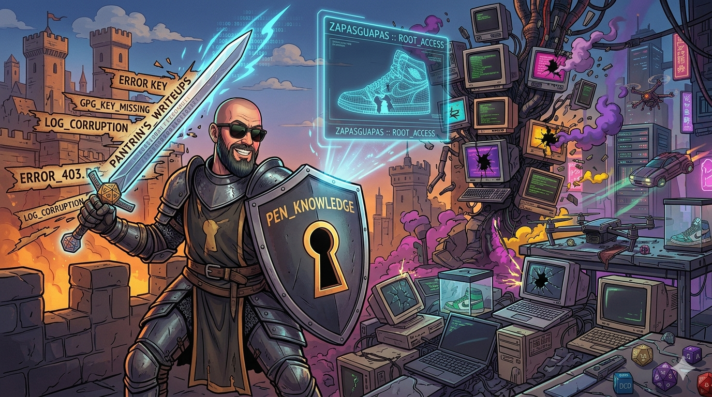

# 🛡️ PanTrO's Pentesting & CTF Labs 🛡️

¡Bienvenidos a mi laboratorio personal de seguridad! Soy **PanTrO**, un apasionado de la ciberseguridad y administrador de sistemas IT que actualmente se encuentra profundizando en el mundo del Red Teaming mientras curso un Máster en Ciberseguridad.

Este repositorio es mi "bitácora de batalla", donde documento el proceso detallado (write-ups) de las máquinas que voy vulnerando en plataformas como **TheHackersLab**, **Dockerlabs** y entornos locales.

---

## 🛠️ Mi Stack Tecnológico

- **OS Principal:** Pop!_OS 🐧 (Amante de la personalización y el troubleshooting de Linux).

- **Laboratorios:** Kali Linux, Debian, VirtualBox.

- **Herramientas de cabecera:** Nmap, John the Ripper, Hydra, Gobuster, AWS CLI, Python & Bash Scripting.

- **Documentación:** Obsidian (para mis cheat sheets y notas rápidas).

---

## 🚀 Write-Ups Destacados

### 👟 [Zapasguapas - TheHackersLab](https://github.com/pantrinn/CTF-Labs-Portfolio/blob/main/TheHackersLab/Zapasguapas/Zapasguapas.md)

- **Dificultad:** Media

- **Técnicas:** RCE en formularios, Cracking de archivos ZIP, Abuso de binarios con SUDO (`apt` & `aws help`).

### 🛡️ [Grillo - TheHackersLab]

- **Dificultad:** Fácil/Media

- **Técnicas:** Enumeración de servicios y escalada de privilegios local.

---

## 🧠 Filosofía de Trabajo

No se trata solo de conseguir la flag; se trata de entender el **porqué** de la vulnerabilidad y cómo mitigarla. En mis write-ups no encontrarás solo comandos, sino la lógica detrás de cada paso, redactada de forma clara y directa.

> _"La seguridad no es un producto, es un proceso."_ — Bruce Schneier

---

## 📫 Contacto & Conexión

Si buscas un perfil de soporte IT, sistemas o ciberseguridad, o quieres intercambiar técnicas, escríbeme:

- **LinkedIn:** [linkedin.com/in/gonzaloccastellano](https://www.linkedin.com/in/gonzaloccastellano)

- **Portfolio Web:** https://github.com/pantrinn

---

_Disclaimer: Todo el contenido de este repositorio tiene fines puramente educativos. No me hago responsable del uso indebido de la información aquí expuesta._

---
